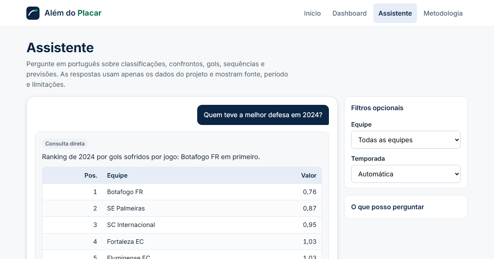
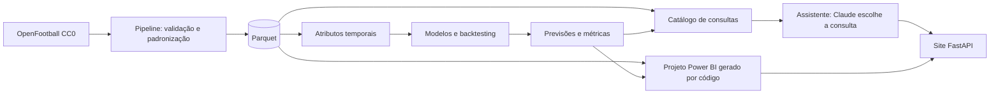

# Além do Placar

Plataforma de inteligência esportiva sobre o **Campeonato Brasileiro Série A (2018–2025)**: engenharia de dados, estatística, Machine Learning, dashboard em Power BI e um assistente de IA que responde em português, sempre com fonte, período e limitações.


**Demonstração pública:** a definir após a publicação (veja `docs/deploy.md`).

## Resultados

| Indicador | Valor |
|---|---|
| Partidas analisadas | 3.040 (380 por temporada, 20 clubes por temporada) |
| Fonte | OpenFootball, licença CC0 |
| Alvo do modelo | Média de pontos nas próximas 5 partidas de uma equipe |
| Modelo selecionado | Ridge, escolhido por validação temporal (2022–2024) |
| Erro no holdout de 2025 (MAE) | **0,478**, contra 0,567 do baseline de média recente |
| Cobertura do intervalo de 90% no holdout | 91,2% |
| Testes automatizados | 337 aprovados, lint sem pendências |

O holdout de 2025 não participou da escolha do modelo. Veja os limites em [Limitações](#limitações).

## O que tem no projeto

| Parte | O que faz |
|---|---|
| **Pipeline de dados** | Coleta, padronização de equipes, validação de integridade e tabelas analíticas em Parquet, consultadas com DuckDB |
| **Atributos e modelagem** | Médias móveis de 3, 5 e 10 jogos, mando de campo, volatilidade; baseline, Ridge, Random Forest e HistGradientBoosting com backtesting de janela expansiva |
| **Explicabilidade** | Importância por permutação, resíduos por equipe e temporada, erros extremos e model card |
| **Dashboard Power BI** | Sete páginas geradas por código, com tema próprio e navegação |
| **Assistente** | Chat em português sobre classificações, confrontos, mando, gols, sequências, rankings e previsões |
| **Site** | Início, dashboard incorporado, assistente e metodologia, com design system próprio |



## Arquitetura



Regras do assistente, definidas no PRD:

- A IA nunca escreve SQL. Ela só escolhe uma consulta de um catálogo fechado e redige a resposta com os números devolvidos.
- Se nenhuma consulta se aplica, a resposta é a frase padrão de "não calculável", e o texto do modelo é descartado.
- Sem chave de API, ou ao atingir o teto diário, o assistente continua em modo determinístico, por palavras-chave.
- Perguntas sobre jogos futuros, clima ou xG recebem recusa explícita. Nenhum valor é inventado.

## Como executar

Requisitos: Python 3.12 e Git.

```powershell
python -m venv .venv
.\.venv\Scripts\Activate.ps1
python -m pip install -e ".[test,lint]"
python -B -m pytest          # testes (ou .\scripts\run_tests.ps1 para testes, lint e formatação)
.\scripts\run_local.ps1      # site e assistente em http://127.0.0.1:8765
```

O diretório `.venv/` é ignorado pelo Git.

Para ativar o assistente com IA, copie `.env.example` para `.env` e preencha `LLM_API_KEY`. O arquivo `.env` nunca vai para o Git.

Para regenerar o projeto Power BI e a imagem de compartilhamento:

```powershell
.\.venv\Scripts\python.exe scripts\gerar_powerbi.py
.\.venv\Scripts\python.exe scripts\gerar_og.py
```

Para conferir uma instância em execução contra cálculos independentes:

```powershell
.\.venv\Scripts\python.exe scripts\smoke_test.py --url http://127.0.0.1:8765
```

## Estrutura

```text
config/            fontes de dados e parâmetros
data/              raw, processed, predictions (somente os artefatos finais vão ao Git)
dashboard/         projeto Power BI gerado, template e tokens de design
docs/              PRD, tarefas, metodologia, model card, contrato da API, deploy, QA
scripts/           execução local, geração do Power BI, teste de fumaça
src/               ingestion, validation, processing, features, models, evaluation, api
tests/             testes unitários e de integração
```

## Documentação

| Documento | Conteúdo |
|---|---|
| `docs/PRD.md` | Requisitos do produto |
| `docs/TASKS.md` | Controle das tarefas e histórico de entregas |
| `docs/methodology.md`, `docs/model_card.md` | Metodologia, modelo, métricas e hipóteses |
| `docs/assistente_catalogo.md`, `docs/api_contrato.md` | Consultas do assistente e contrato da API |
| `docs/dashboard_setup.md` | Geração e validação do Power BI |
| `docs/deploy.md` | Publicação no Render e no Power BI |
| `docs/roadmap.md` | Próximas melhorias |

## Limitações

- Dados observacionais de uma única competição, com cerca de 33 observações por equipe no holdout. Os resultados não são causais.
- Um único holdout temporal. Os alvos de partidas consecutivas se sobrepõem, então as observações não são independentes e não há teste de significância.
- A hipótese de que a média móvel recente supera a média histórica **não se confirmou** na validação (MAE 0,604 contra 0,515 da média histórica global). O Ridge superou as duas referências na validação (MAE 0,489), mas o experimento não isola a contribuição de cada atributo.
- Não há xG: a hipótese sobre métricas avançadas não pôde ser avaliada. Dados de 2026 não foram usados.
- Previsões são estimativas retrospectivas, não certezas nem recomendação de aposta.
- A chamada à Claude API foi testada com cliente simulado. A integração real depende de uma chave e ainda precisa de um teste manual.
- O projeto Power BI foi gerado e testado por código, mas a abertura no Power BI Desktop depende de validação manual (`docs/qa/T008/checklist_desktop.md`).

## Status do fluxo de trabalho

As tarefas T001 a T009 têm código entregue e testado. Revisão técnica independente, QA funcional e aprovação final do responsável pelo projeto estão pendentes, e a publicação aguarda autorização. O histórico está em `docs/TASKS.md`.

## Licença

Código sob licença MIT (`LICENSE`). Dados de partidas do OpenFootball em domínio público (CC0). Os arquivos de `dashboard/powerbi` mantêm os avisos de licença da Microsoft. Os escudos são marcas dos clubes, exibidos a partir da Wikimedia apenas para identificação, sem fins comerciais.
