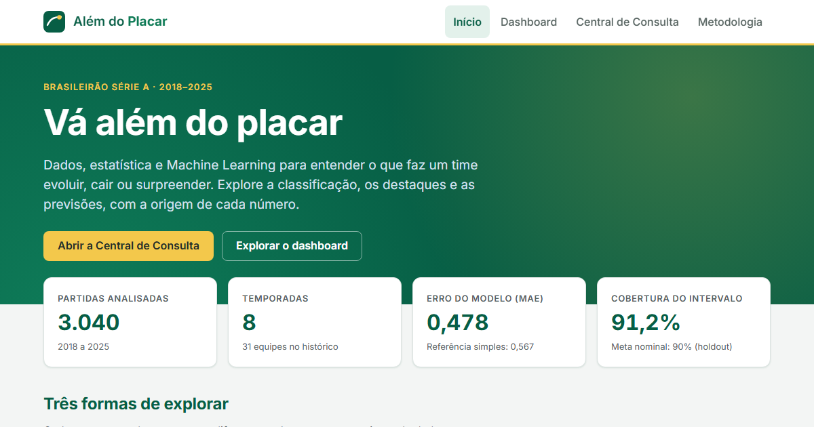
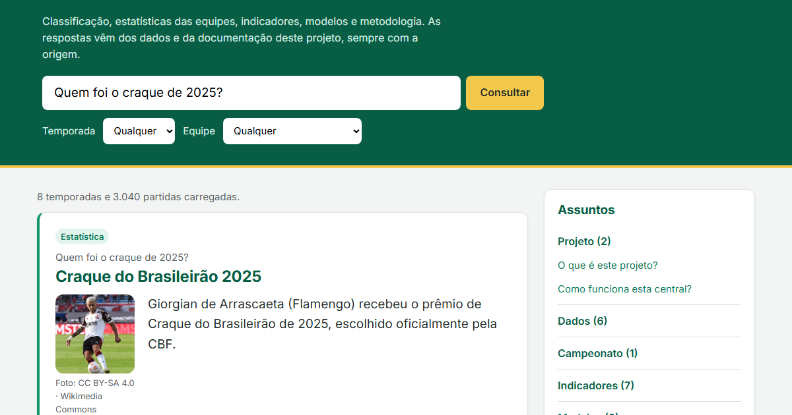
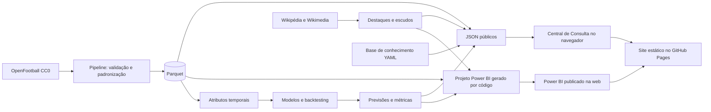

# Além do Placar

Projeto de **Business Intelligence e Ciência de Dados** sobre o Campeonato Brasileiro Série A (2018–2025): pipeline de dados, análise exploratória, engenharia de atributos, Machine Learning com validação temporal, dashboard em Power BI e uma **Central de Consulta** que responde perguntas sobre o campeonato e o projeto, sem inteligência artificial paga.



**Links:** site e Central de Consulta (GitHub Pages) e dashboard público do Power BI serão adicionados após a publicação. Passo a passo em `docs/deploy.md`.

## Objetivo

Responder com dados se o desempenho recente de uma equipe ajuda a antecipar os próximos jogos, e apresentar a resposta de forma que um torcedor entenda, um usuário leigo consiga explorar e um recrutador consiga auditar.

Perguntas analisadas:

- Quem foi campeão, quem caiu e como cada clube evoluiu entre temporadas?
- Quais equipes têm melhor ataque, defesa, regularidade e desempenho em casa e fora?
- É possível prever a média de pontos dos próximos 5 jogos? Com que erro?
- Um modelo de Machine Learning supera uma regra simples?

## Resultados

| Indicador | Valor |
|---|---|
| Partidas analisadas | 3.040 (8 temporadas completas, 380 partidas cada) |
| Fonte | OpenFootball, licença CC0 |
| Alvo do modelo | Média de pontos nos próximos 5 jogos da equipe |
| Modelo selecionado | Regressão Ridge, escolhido na validação de 2022 a 2024 |
| Erro médio absoluto no teste de 2025 | **0,478 ponto por jogo**, contra 0,567 da média dos últimos 5 jogos |
| Cobertura da faixa de 90% no teste | 91,2% |
| Testes automatizados | 367 (Python e Node), lint sem pendências |

O teste de 2025 não participou da escolha do modelo. A auditoria completa está em `docs/auditoria_ciencia_dados.md`.

## O que tem no projeto

| Parte | O que faz |
|---|---|
| **Pipeline de dados** | Leitura do OpenFootball, padronização dos nomes dos clubes, validação de integridade e tabelas em Parquet, consultadas com DuckDB |
| **Atributos e modelagem** | 12 atributos temporais sem vazamento; duas referências e três modelos (Ridge, Random Forest, Gradient Boosting) com backtesting de janela expansiva |
| **Explicabilidade** | Importância por permutação, resíduos por equipe e temporada, erros extremos e model card |
| **Dashboard Power BI** | Sete páginas geradas por código, com identidade visual do futebol brasileiro: Visão Geral, Tendências, Estatísticas, Modelos, Previsões, Central de Consulta e Metodologia |
| **Central de Consulta** | Busca em português sobre classificação, confrontos, artilheiros, indicadores, modelos e metodologia; estatísticas calculadas no navegador a partir das partidas |
| **Site estático** | Início, dashboard incorporado, Central e metodologia, publicados no GitHub Pages sem servidor |



### Visão Geral do dashboard

- Classificação da temporada com escudos, posição, pontos, jogos, vitórias, empates, derrotas, saldo, aproveitamento e zona (Libertadores, Sul-Americana, rebaixamento).
- Desempate pelos critérios da CBF disponíveis nos dados: pontos, vitórias, saldo e gols marcados. As medidas ficam vazias se mais de uma temporada for selecionada, para nunca misturar anos.
- Destaques reais da temporada: artilheiro, Craque do Brasileirão e Melhor Goleiro (prêmios oficiais, via Wikipédia), com foto de licença livre ou silhueta, e melhor ataque calculado.
- 2025 e Flamengo como seleção inicial.

### Central de Consulta

- Sem API paga e sem servidor: base de conhecimento em `config/central_conhecimento.yaml` e partidas em JSON.
- Os números das explicações são preenchidos a partir dos dados na geração; nada é escrito à mão.
- Perguntas fora do tema recebem uma recusa educada. Perguntas no tema sem dados recebem "Não encontrei informações suficientes nos dados disponíveis para responder com segurança.".
- Trata temporada inexistente, equipe ausente, nome ambíguo ("Atlético"), jogador sem foto e métricas indisponíveis (xG, posse).

## Tecnologias

Python 3.12 · pandas · DuckDB · PyArrow · scikit-learn · MLflow (local) · FastAPI (servidor local opcional) · Power BI (PBIP/PBIR, DAX, Power Query) · HTML, CSS e JavaScript sem framework · pytest · Node test runner · Ruff · GitHub Actions

## Arquitetura



## Metodologia de validação

1. Atributos calculados por equipe e temporada em ordem cronológica, só com jogos encerrados.
2. Validação temporal: para cada ano de 2022 a 2024, treino apenas com o passado; uma linha só entra no treino quando os 5 jogos do seu alvo já terminaram.
3. Escolha do modelo só na validação: ganho mínimo de 2% no MAE e nenhuma temporada com piora acima de 10%.
4. Teste único em 2025, com o modelo já escolhido.
5. Faixa de 90% a partir dos erros da validação, com cobertura medida no teste.

Detalhes em `docs/methodology.md`, `docs/model_card.md` e `docs/auditoria_ciencia_dados.md`. Nomes, tipos e fórmulas de todas as variáveis estão em `docs/dicionario_de_dados.md`.

## Como executar

Requisitos: Python 3.12 e Git; Node.js para os testes do motor da Central (opcional).

```powershell
python -m venv .venv
.\.venv\Scripts\Activate.ps1
python -m pip install -e ".[test,lint]"
python -B -m pytest          # testes (ou .\scripts\run_tests.ps1 para testes, lint e formatação)
.\scripts\run_local.ps1      # site e Central em http://127.0.0.1:8765
```

O diretório `.venv/` é ignorado pelo Git.

Outras tarefas:

```powershell
python scripts\build_site.py         # site estático em site/
python scripts\gerar_powerbi.py      # projeto Power BI em dashboard/powerbi/AlemDoPlacar
python scripts\gerar_dicionario.py   # docs/dicionario_de_dados.md
python scripts\obter_escudos.py      # atualiza config/escudos.csv (Wikipédia)
python scripts\obter_destaques.py    # atualiza config/destaques.csv (Wikipédia)
python scripts\smoke_test.py --url http://127.0.0.1:8765
```

## Estrutura

```text
config/            fontes, base de conhecimento da Central, escudos e destaques
data/              processed e predictions versionados; raw fora do Git
dashboard/         projeto Power BI gerado, template e tokens de design
docs/              PRD, tarefas, metodologia, model card, auditoria, dicionário, deploy e QA
scripts/           execução local, geração do site, do Power BI e do dicionário, teste de fumaça
src/               ingestion, validation, processing, features, models, evaluation, api
tests/             testes Python (unit) e JavaScript (js)
```

## Limitações

- Dados observacionais de uma única competição, com cerca de 33 observações por equipe no teste. Os resultados não são causais.
- Um único período de teste. Os alvos de jogos consecutivos se sobrepõem, então não há teste de significância.
- A hipótese de que a média recente supera a média histórica **não se confirmou** na validação.
- A faixa de 90% é empírica e tem o mesmo tamanho para todas as previsões.
- Não há xG, finalizações, posse de bola nem estatísticas individuais por jogo.
- As zonas da tabela não consideram vagas extras por títulos de copas.
- Artilheiros e prêmios vêm da Wikipédia, sem conferência direta com a CBF.
- O dashboard é gerado por código. A versão anterior foi aberta e conferida no Power BI Desktop; a versão atual precisa ser reaberta lá antes de publicar (`docs/qa/T008/checklist_desktop.md`).

## Status do fluxo de trabalho

O código das tarefas T001 a T010 está entregue e testado. Revisão técnica independente, QA funcional e aprovação final do responsável estão pendentes, e a publicação aguarda autorização. Histórico em `docs/TASKS.md`.

## Licença

Código sob licença MIT (`LICENSE`). Partidas do OpenFootball em domínio público (CC0). Fotos de jogadores da Wikimedia Commons com licenças livres, creditadas no dashboard e na Central. Os escudos são marcas dos clubes, exibidos a partir da Wikimedia apenas para identificação, sem fins comerciais. Os arquivos de `dashboard/powerbi` mantêm os avisos de licença da Microsoft.
